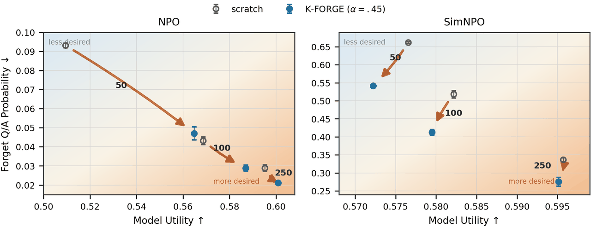
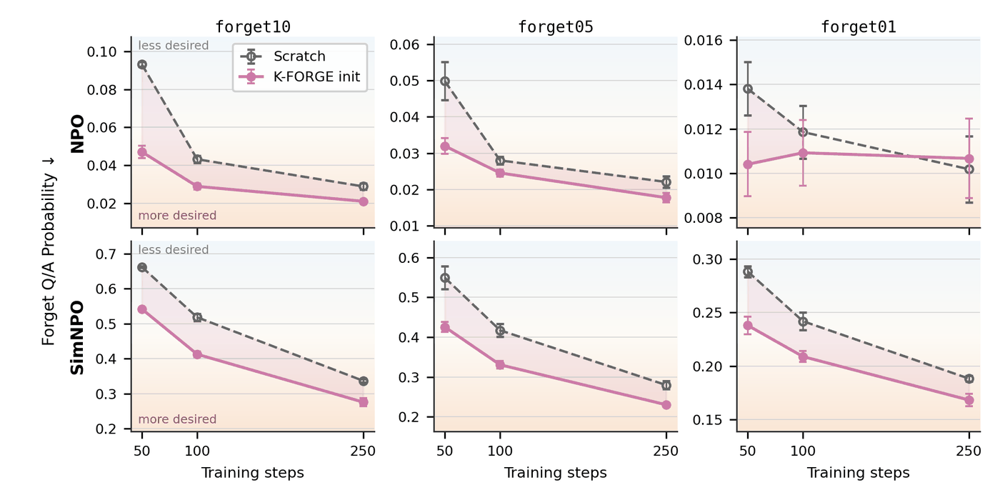

<div align="center">

# K-FORGE



### Kronecker-Fisher One-shot Rank-r Generalized Erasure
**Fisher-Guided Initialization for Preference-Based LLM Unlearning**

[Daniil Moskovskiy](https://github.com/etomoscow) (AIRI, Skoltech) · [Alexander Panchenko](https://scholar.google.com/citations?user=k0WGO7YAAAAJ) (Skoltech, AIRI)

*Implemented on top of [OpenUnlearning](https://github.com/locuslab/open-unlearning)*

</div>

---

## TL;DR

**K-FORGE** is a **training-free, closed-form edit** that uses forget- and retain-set **Kronecker–Fisher factors** to build a retain-aware low-rank "Wiener" edit of the model, and then uses the edited checkpoint as the **initialization for NPO / SimNPO** unlearning.

- One-shot: stronger edits lower Forget Q/A Probability but spend Model Utility — so the edit is best used as a **starting direction**, not as the final unlearned model.
- With setup time and FLOPs fully charged, K-FORGE-initialized **NPO reduces Forget Q/A Probability by 22.3%** (p = 0.007) and **improves utility** while using **less total wall time and compute** than training from the pretrained checkpoint.
- The gains hold for NPO and SimNPO on TOFU `forget10`/`forget05`, transfer to Gemma-3-1B, and are **not** explained by random, weight-SVD, diagonal-Fisher, or forget-only initializer controls.
- Honest boundaries: no relearning resistance (direct relearning recovers the forgotten data), MUSE results vary by metric, and Qwen2.5 is nearly unchanged.

---

## Method

For every regex-selected `torch.nn.Linear` module (default: `.*mlp\.down_proj$`), K-FORGE:

1. **Calibrates** empirical K-FAC-style Kronecker factors on forget and retain batches — `A = E[x xᵀ]` from layer inputs, `B = E[g gᵀ]` from output gradients (valid causal-LM loss positions only, eval mode).
2. **Simultaneously diagonalizes** the forget/retain factor pairs.
3. Applies a **retain-aware Wiener edit** with a `lambda_tradeoff` retain budget, truncates to rank *r* in the rescaled basis, and maps back through retain whitening.
4. **Folds** the edit into the base checkpoint — afterwards you run **unchanged** NPO or SimNPO from the edited model.

The only backward passes are the calibration passes; the edit itself is closed-form. Two variants are available: `wiener_v2` (the theorem-backed edit used for all headline results) and `legacy_v1` (the original heuristic, kept for ablation only).

Full method description, theory, and proofs: [`open-unlearning/docs/kforge.md`](open-unlearning/docs/kforge.md) and the paper source on the `dev` branch (`main.tex`).

---

## Installation

```bash
git clone https://github.com/etomoscow/kron_unlearn.git
cd kron_unlearn/open-unlearning

conda create -n unlearning python=3.11
conda activate unlearning
pip install ".[lm-eval]"
pip install --no-build-isolation flash-attn==2.6.3

# Data setup (TOFU / MUSE / WMDP)
python setup_data.py --eval
```

## Quick start

**One-shot K-FORGE edit** (TOFU, Llama-3.2-1B-Instruct):

```bash
python src/train.py --config-name=unlearn \
  experiment=unlearn/tofu/kforge \
  task_name=kforge_edit
```

**K-FORGE as initialization for NPO** (run the edit first, then point the downstream method at the edited checkpoint):

```bash
# 1) one-shot edit (paper headline init uses wiener_v2 + lambda_tradeoff=0.01)
python src/train.py --config-name=unlearn \
  experiment=unlearn/tofu/kforge \
  trainer.method_args.edit_variant=wiener_v2 \
  trainer.method_args.lambda_tradeoff=0.01 \
  trainer.method_args.strength=0.45 \
  task_name=kforge_init

# 2) downstream NPO / SimNPO from the edited checkpoint
python src/train.py --config-name=unlearn \
  experiment=unlearn/tofu/default \
  model.model_args.pretrained_model_name_or_path=saves/unlearn/kforge_init \
  trainer=NPO \
  task_name=npo_from_kforge
```

### Key knobs (`trainer.method_args`)

| Argument | Default | Meaning |
|---|---|---|
| `target_modules_regex` | `.*mlp\.down_proj$` | Full-match regex over module names |
| `rank` | `8` | Truncated SVD rank per layer |
| `strength` | `1.0` | Multiplier α on the negative edit |
| `damping` | `1e-4` | Tikhonov damping applied before Cholesky |
| `max_calibration_batches` | `8` | Forget/retain batches used for factor estimation |
| `max_target_modules` | `4` | Cap on matched modules (`null` = all) |
| `factor_mode` | `kron` | `kron` or `diagonal` (diagonal-Fisher ablation) |
| `use_retain_fisher` | `true` | `false` = forget-only-Fisher ablation |
| `edit_variant` | `legacy_v1` | `wiener_v2` for the paper results |
| `lambda_tradeoff` | `0.0` | Retain-Fisher penalty (used by `wiener_v2` only) |
| `edit_weight_dtype` | `float32` | Keeps small edits representable after serialization |

---

## Results

All numbers are taken from the paper. Primary endpoint: **Forget Q/A Probability** (lower = less probability on gold forget answers). Unless stated otherwise: TOFU `forget10`, Llama-3.2-1B-Instruct, *n* = 3 seeds, mean ± std.

### 1. One-shot strength sweep

Stronger edits monotonically trade utility for forgetting — raising α from 0.1 to 0.8 drops Forget Q/A Probability from 0.878 to 0.411 while utility falls from 0.599 to 0.513. This trade-off motivates using the edit as an **initializer** rather than the final model:

| Method | Utility ↑ | Forget Pr. ↓ | ROUGE ↓ | Extraction ↓ |
|---|---|---|---|---|
| Base model | **0.599** | 0.881 | 0.820 | 0.706 |
| K-FORGE α = 0.100 | **0.599** | 0.878 | 0.814 | 0.698 |
| K-FORGE α = 0.300 | 0.595 | 0.837 | 0.721 | 0.592 |
| K-FORGE α = 0.350 | 0.594 | 0.821 | 0.692 | 0.542 |
| K-FORGE α = 0.450 | 0.582 | 0.774 | 0.613 | 0.390 |
| K-FORGE α = 0.600 | 0.556 | 0.657 | 0.539 | 0.262 |
| K-FORGE α = 0.800 | 0.513 | **0.411** | **0.427** | **0.130** |

### 2. K-FORGE vs. scratch initialization (main comparison)

| Steps | Method | Init | Utility ↑ | Forget Prob. ↓ | Extraction ↓ |
|---|---|---|---|---|---|
| 50 | NPO | scratch | 0.509 ± 0.004 | 0.093 ± 0.001 | **0.068 ± 0.002** |
| | | K-FORGE (0.450) | 0.565 ± 0.003 | 0.047 ± 0.003 | 0.072 ± 0.003 |
| | | K-FORGE (0.600) | **0.574 ± 0.004** | **0.045 ± 0.003** | 0.071 ± 0.001 |
| | SimNPO | scratch | **0.577 ± 0.006** | 0.662 ± 0.003 | 0.270 ± 0.010 |
| | | K-FORGE (0.450) | 0.572 ± 0.007 | 0.542 ± 0.002 | 0.192 ± 0.002 |
| | | K-FORGE (0.600) | 0.571 ± 0.005 | **0.534 ± 0.002** | **0.188 ± 0.005** |
| 100 | NPO | scratch | 0.569 ± 0.009 | 0.043 ± 0.002 | **0.065 ± 0.003** |
| | | K-FORGE (0.450) | 0.587 ± 0.002 | **0.029 ± 0.002** | 0.073 ± 0.003 |
| | | K-FORGE (0.600) | **0.593 ± 0.005** | 0.031 ± 0.002 | 0.073 ± 0.003 |
| | SimNPO | scratch | **0.582 ± 0.002** | 0.518 ± 0.010 | 0.172 ± 0.013 |
| | | K-FORGE (0.450) | 0.579 ± 0.003 | 0.413 ± 0.008 | **0.143 ± 0.002** |
| | | K-FORGE (0.600) | 0.582 ± 0.002 | **0.407 ± 0.011** | 0.144 ± 0.005 |
| 250 | NPO | scratch | 0.595 ± 0.009 | 0.029 ± 0.002 | **0.064 ± 0.003** |
| | | K-FORGE (0.450) | 0.601 ± 0.003 | **0.021 ± 0.001** | 0.072 ± 0.003 |
| | | K-FORGE (0.600) | **0.603 ± 0.004** | 0.022 ± 0.001 | 0.074 ± 0.001 |
| | SimNPO | scratch | **0.596 ± 0.003** | 0.337 ± 0.005 | 0.116 ± 0.004 |
| | | K-FORGE (0.450) | 0.595 ± 0.001 | 0.276 ± 0.012 | 0.111 ± 0.003 |
| | | K-FORGE (0.600) | 0.592 ± 0.004 | **0.272 ± 0.008** | **0.110 ± 0.001** |

*At every matched budget K-FORGE lowers forget probability; the largest NPO gain is early (−49% at 50 steps) and SimNPO gains are steadier (−18…−20%) at essentially unchanged utility.*



*Trajectories on TOFU `forget10` / `forget05` / `forget01` (Figure 2 in the paper). Gains are clearest on `forget10`/`forget05`; NPO on `forget01` is near the noise floor.*

### 3. Initializer controls — it's not just "any low-rank edit"

| Method | Init | U @ S50 ↑ | FP @ S50 ↓ | U @ S100 ↑ | FP @ S100 ↓ |
|---|---|---|---|---|---|
| NPO | scratch | 0.509 ± 0.004 | 0.093 ± 0.001 | 0.569 ± 0.009 | 0.043 ± 0.002 |
| | random | 0.516 ± 0.004 | 0.082 ± 0.005 | 0.579 ± 0.008 | 0.038 ± 0.005 |
| | weight-SVD | 0.538 ± 0.012 | 0.084 ± 0.006 | **0.587 ± 0.003** | 0.043 ± 0.001 |
| | diagonal | 0.561 ± 0.007 | 0.058 ± 0.007 | 0.584 ± 0.011 | 0.033 ± 0.001 |
| | forget-only | 0.543 ± 0.004 | 0.062 ± 0.004 | 0.582 ± 0.003 | 0.032 ± 0.001 |
| | **K-FORGE** | **0.565 ± 0.003** | **0.047 ± 0.003** | **0.587 ± 0.002** | **0.029 ± 0.002** |
| SimNPO | scratch | 0.577 ± 0.006 | 0.662 ± 0.003 | 0.582 ± 0.002 | 0.518 ± 0.010 |
| | random | **0.578 ± 0.011** | 0.650 ± 0.004 | 0.584 ± 0.001 | 0.515 ± 0.002 |
| | weight-SVD | 0.574 ± 0.005 | 0.619 ± 0.006 | **0.585 ± 0.003** | 0.488 ± 0.005 |
| | diagonal | 0.570 ± 0.003 | 0.607 ± 0.002 | 0.583 ± 0.003 | 0.500 ± 0.007 |
| | forget-only | 0.572 ± 0.005 | 0.619 ± 0.006 | 0.583 ± 0.001 | 0.491 ± 0.004 |
| | **K-FORGE** | 0.572 ± 0.007 | **0.542 ± 0.002** | 0.579 ± 0.003 | **0.413 ± 0.008** |

*K-FORGE has the lowest mean Forget Q/A Probability in every optimizer × budget block.*

### 4. Compute overhead (charged, not free)

One-time setup for one edited layer (2048×8192 @ 1B / 3072×8192 @ 3B, 512 calibration examples):

| Model | Time (s): calib / edit / end-to-end | FLOPs | Eq. steps (NPO / SimNPO) |
|---|---|---|---|
| 1B | 18 / 62 / ≤ 81 | 3.621 × 10¹⁴ | 7.0 / 8.2 |
| 3B | 51 / 104 / ≤ 145 | 9.287 × 10¹⁴ | 6.9 / 8.1 |

Strict compute-matched comparison (FP32, *n* = 3, evaluation excluded from timing; K-FORGE totals include the full 80.2 s setup):

| Method | Init | Steps | FLOPs ×10¹⁵ (train + setup) | Wall (s) | Forget Prob. ↓ | Utility ↑ |
|---|---|---|---|---|---|---|
| NPO | Scratch | 73 | 3.78 + 0.00 | 285.5 | 0.059 | 0.549 |
| NPO | K-FORGE | 50 | 2.59 + 0.36 | **277.2** | **0.046** | **0.577** |
| SimNPO | Scratch | 86 | 3.80 + 0.00 | 221.6 | 0.553 | **0.583** |
| SimNPO | K-FORGE | 50 | 2.21 + 0.36 | **210.5** | **0.537** | 0.572 |

*For NPO: −22.3% forget probability (p = 0.007) and +0.028 utility (p < 0.001) with less time and fewer FLOPs. SimNPO: −2.8% probability (descriptive, p = 0.126) with slightly lower utility.*

### 5. Transfer beyond the primary setup

- **Llama-3.2-3B** (α = 0.45, 3 budgets): SimNPO improves utility, forget probability, extraction, and ROUGE at all budgets; NPO improves strongly at 50 steps but is worse at 100/250.
- **Gemma-3-1B-IT** (α = 0.80, 100 steps, *n* = 4): NPO forget probability 0.066 → 0.053, extraction 0.055 → 0.033, utility unchanged (0.401); SimNPO 0.272 → 0.269.
- **Qwen2.5-1.5B** (SimNPO pilot): no change at reported precision (0.262 / 0.345 for both inits).
- **MUSE** (Llama-2-7B, SimNPO): results vary by metric — News at 100 steps, α = 1.0 lowers extraction (0.303 → 0.301) and VerbMem (0.573 → 0.551) with a small retain-quality drop; Books is mixed.

### 6. Robustness boundaries (reported honestly)

- **Direct relearning recovers the data.** After 13 relearning updates, forget probability rises by +0.494 (K-FORGE) vs +0.329 (scratch), p < 0.001. K-FORGE improves the pre-attack trajectory but does **not** prevent relearning.
- **Quantized loading is milder**: 8-bit changes forget probability by +0.002/+0.002 and 4-bit by +0.008/+0.012 (NPO pair); the SimNPO advantage survives quantization on Llama but is erased/reversed for NPO on Gemma.

---

## Where things live

```
kron_unlearn/
├── assets/                                # the two paper figures used in this README
├── open-unlearning/                       # OpenUnlearning fork with K-FORGE
│   ├── src/trainer/unlearn/kforge.py      # KFORGE trainer (factors + Wiener edit)
│   ├── configs/trainer/KFORGE.yaml        # trainer defaults
│   ├── configs/experiment/unlearn/tofu/kforge.yaml
│   ├── docs/kforge.md                     # method & configuration reference
│   └── saves/figures/kforge_corrected/    # paper figures + underlying CSV data (MANIFEST.md)
└── (branch: dev)                          # paper source (main.tex), research notes, reports
```

Figure data (per-point CSVs for every plot above) are in `open-unlearning/saves/figures/kforge_corrected/` — see its [MANIFEST.md](open-unlearning/saves/figures/kforge_corrected/MANIFEST.md).

## Citation

If you use K-FORGE, please cite:

```bibtex
@misc{moskovskiy2026kforge,
  title         = {K-FORGE: Fisher-Guided Initialization for Preference-Based LLM Unlearning},
  author        = {Moskovskiy, Daniil and Panchenko, Alexander},
  year          = {2026},
  howpublished  = {\url{https://github.com/etomoscow/kron_unlearn}}
}
```

## Acknowledgements

K-FORGE is built on [OpenUnlearning](https://github.com/locuslab/open-unlearning) and evaluates with [TOFU](https://github.com/locuslab/tofu) and [MUSE](https://github.com/swj0419/muse_bench). The Kronecker-Fisher construction builds on [K-FAC](https://arxiv.org/abs/1503.05671) and [GFWSVD](https://arxiv.org/abs/2505.17974).
